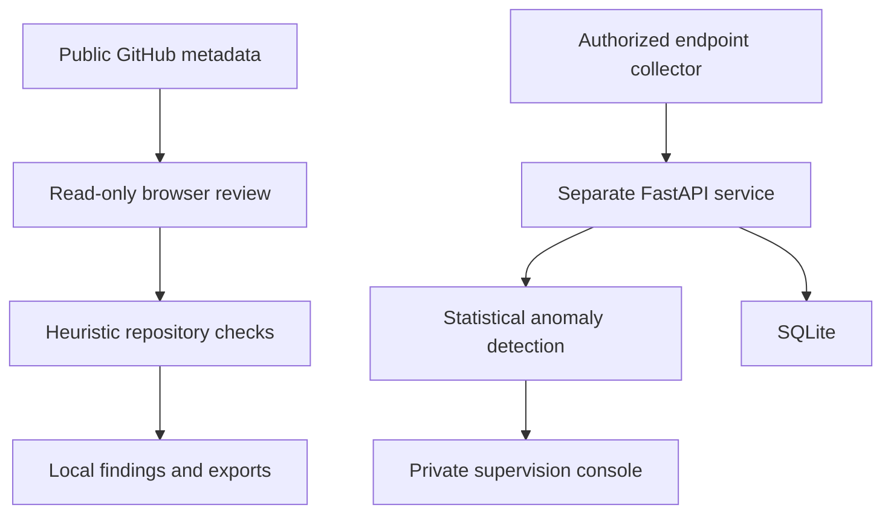

# AEGIS — White Hat Security OS · Studio Niko Design

**Defensive repository review · Local endpoint telemetry · Explainable anomaly detection**

 · [Sentinel](sentinel/README.md) · [English overview](#english-overview)

## Architecture et algorithmes

Deux composants distincts : la page statique [index.html](index.html) et le service Python [Sentinel](sentinel/README.md). La page publique n'exécute pas le serveur ni le collecteur.

| Source | Fonction constatée |
| --- | --- |
| [index.html](index.html) | Inventaire public, contrôles de présence et heuristiques de workflows, constats manuels |
| [sentinel/aegis/engine.py](sentinel/aegis/engine.py) | Détection statistique par médiane et MAD à partir de 12 mesures ; Isolation Forest conditionnel à partir de 30 mesures historiques |
| [sentinel/aegis/security.py](sentinel/aegis/security.py) | Hachage scrypt, sessions signées HMAC-SHA256, empreintes de jetons |
| [sentinel/agent/collector.py](sentinel/agent/collector.py) | Collecte sur terminaux autorisés |
| [sentinel/aegis/audit.py](sentinel/aegis/audit.py) | Journal d'audit administratif |

Le modèle Isolation Forest utilise 60 arbres et une graine fixe dans le code inspecté. Une anomalie statistique n'est pas une preuve d'intrusion ; les seuils et scores n'ont pas été qualifiés ici. Les contrôles de workflows ne remplacent pas une analyse sémantique ou une revue humaine. Ne jamais interpréter une source inaccessible, tronquée ou un capteur absent comme un contrôle réussi.

**AEGIS** est un cockpit de cybersécurité éthique consacré aux repositories publics de [Nikoju1977](https://github.com/Nikoju1977). Il est conçu pour l'inventaire et les contrôles défensifs en **lecture seule**.

## Ouvrir l'application

**https://nikoju1977.github.io/White-hat/** (accessible après le premier déploiement GitHub Pages réussi).

## Fonctions

- Tableau de bord et inventaire des dépôts publics GitHub, recherche et filtres.
- Audit heuristique des bonnes pratiques : README, LICENSE, SECURITY.md, Dependabot, lockfiles et configuration GitHub Actions.
- Contrôles approximatifs des références d'actions non épinglées, permissions larges et `pull_request_target`.
- Constatations manuelles avec gravité, statut, recommandations et exports JSON/CSV.
- Rapports imprimables et outils locaux (SHA-256, en-têtes HTTP, robustesse de mot de passe).
- Interface responsive 100 % statique, sans serveur et sans jeton GitHub.

**Limites :** les résultats ne constituent pas un audit de vulnérabilités complet. Aucun scan intrusif, exploitation, SAST réel, accès aux dépôts privés ou modification automatique des dépôts n'est réalisé. Les constats restent dans le stockage local du navigateur ; le site public n'héberge pas ces données.

## AEGIS Sentinel AI — protection et supervision des terminaux

**[Accéder au code source de Sentinel v0.2](sentinel/README.md)** — collecteurs Windows/macOS/Linux, serveur FastAPI, console PWA, analyse d’anomalies locale, capteurs IDS optionnels, détection d’intégrité des fichiers, traçabilité des actions et tests automatisés.

**À installer séparément :** GitHub Pages héberge seulement la vitrine statique AEGIS ; il ne lance ni le serveur Python, ni les collecteurs de Sentinel. La PWA mobile est une console de supervision, pas un antivirus iOS/Android.

## Publication via GitHub Pages

Le workflow `.github/workflows/deploy-pages.yml` publie automatiquement le site au push sur `main`.

1. Dans ce repository, ouvre **Settings → Pages**.
2. Dans **Build and deployment → Source**, sélectionne **GitHub Actions**.
3. Consulte l'onglet **Actions** pour vérifier l'exécution de « Publish AEGIS on GitHub Pages ».
4. Après succès, ouvre [AEGIS](https://nikoju1977.github.io/White-hat/).

Les fichiers HTML/CSS/JS sont regroupés dans `index.html` pour permettre un déploiement statique autonome. Les liens relatifs et les routes par fragments (`#`) fonctionnent sous le chemin `/White-hat/`.

## Sécurité et confidentialité

L'application utilise uniquement l'API GitHub publique (`api.github.com`) depuis le navigateur, sans token ni connexion OAuth. L'API anonyme peut imposer environ 60 requêtes par heure et par adresse IP. L'application ne lit pas le contenu des fichiers `.env`; elle peut détecter leur présence par le nom et signale les limites de ses contrôles. Les analyses ne prouvent jamais qu'un projet est exempt de failles.

Ce projet est réservé aux utilisations autorisées et à l'amélioration de la sécurité.

## Licence

Licence MIT. Les services externes et contenus de tiers restent soumis à leurs conditions respectives.

## Qualification proposée

Sur un environnement de laboratoire autorisé et des données fictives : vérifier les états inconnus et les erreurs API, les faux positifs des contrôles, la révocation des identifiants, l'intégrité du journal et les comportements sur séries stables ou atypiques. Évaluer séparément les composants Python, le navigateur et les capteurs externes. Ne jamais publier de jetons ni de données de télémétrie sensibles. La journalisation locale n'est pas une garantie d'immutabilité. Aucun scan intrusif, test d'exécution, audit indépendant ou déploiement n'a été réalisé pour cette révision.

## English overview

AEGIS combines a read-only public GitHub review interface with a separate Sentinel endpoint-supervision service. The latter implements robust statistical checks and conditional Isolation Forest anomaly detection, not proof of intrusion or certified endpoint protection. GitHub Pages does not run Python collectors or the API. Use only authorized systems; review findings manually. No new runtime, security or deployment tests were performed.

The existing MIT license and third-party notices are unchanged.
